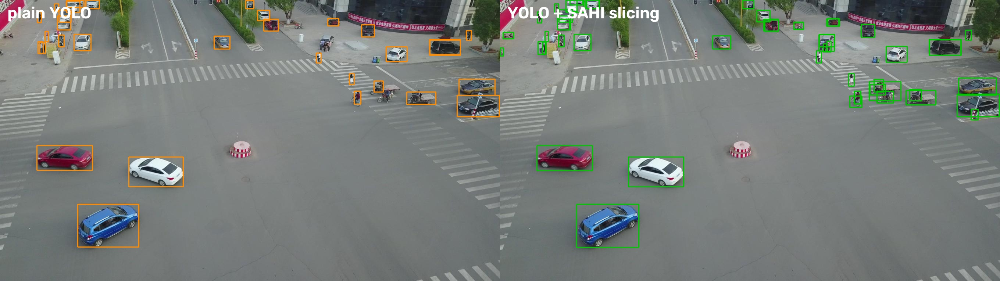
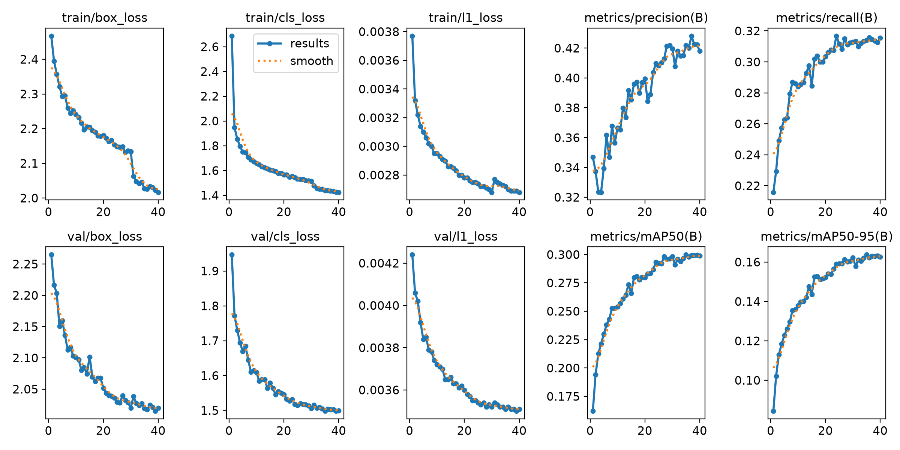
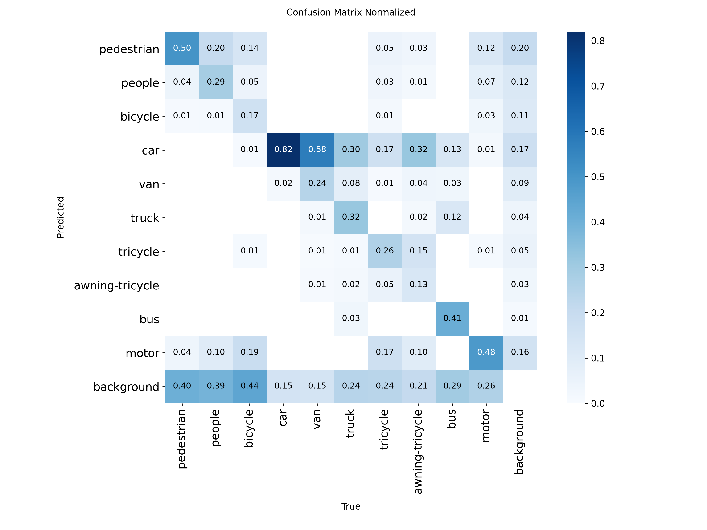

# Aerial Object Detection: YOLO26 on VisDrone + SAHI

Fine-tunes YOLO26-nano on **VisDrone2019-DET**, a dataset of drone images with tiny, dense objects (pedestrians, cars, motorbikes seen from 50–150 m). It then checks how much **sliced inference (SAHI)** helps with small objects.



## Why drone footage is hard

- **Tiny objects.** In 200 validation images, 69 % of the 14 135 labelled objects are smaller than 32×32 px.
- **Density.** Some frames hold hundreds of objects.
- **Downscaling.** A 2000×1500 drone frame is shrunk to 640 px for the network, so a 20-px pedestrian becomes about 6 px and practically disappears.

## Training

| Setting | Value |
|---|---|
| Model | `yolo26n.pt` (COCO-pretrained, 2.4 M params) |
| Data | VisDrone2019-DET: 6 471 train / 548 val images, 10 classes |
| Epochs / image size / batch | 40 / 640 / 8 |
| Hardware | RTX 3050 Laptop 4 GB, ~3 min per epoch, ~2 h total |



All losses still go down and the val loss shows no overfitting. mAP is levelling off near epoch 40. The step at epoch 30 comes from mosaic augmentation being switched off for the last 10 epochs (an Ultralytics default).

### Validation results (548 images, 38 759 objects)

| Metric | Value |
|---|---|
| mAP50 | **0.290** |
| mAP50-95 | **0.161** |
| Precision / Recall | 0.419 / 0.315 |
| Inference | 3.3 ms per image on GPU |

| Class | mAP50-95 | | Class | mAP50-95 |
|---|---|---|---|---|
| car | 0.461 | | pedestrian | 0.132 |
| bus | 0.258 | | motor | 0.123 |
| van | 0.216 | | tricycle | 0.094 |
| truck | 0.168 | | people | 0.075 |
| | | | awning-tricycle | 0.060 |
| | | | bicycle | 0.023 |

Cars are the largest and most common class, so they are learned well. Bicycles and seated "people" are only a few pixels tall at 640 px, which is where slicing helps.



## SAHI: sliced inference

[SAHI](https://github.com/obss/sahi) cuts the full-resolution image into overlapping 640×640 tiles and runs the detector on each tile (plus the whole image). It then merges the boxes. Small objects keep their real pixel size, at the cost of more forward passes.

Same model, same 200 validation images, confidence 0.25. A detection counts as a hit when it overlaps a ground-truth box of the same class with IoU ≥ 0.5:

| | Plain YOLO | YOLO + SAHI |
|---|---|---|
| Recall (all objects) | 0.388 | **0.547** (+41 %) |
| Recall, small objects (<32² px) | 0.251 | **0.441** (+75 %) |
| Precision | **0.711** | 0.599 |
| Time per image (RTX 3050) | **40 ms** | 110 ms |

**Takeaway.** Slicing finds roughly 1.75× more small objects but is about 2.8× slower and produces somewhat more false positives. It suits offline analysis of drone footage or high-resolution stills. For real-time on-board use, a common compromise is a larger input size (`imgsz=1280`) or training directly on tiles.

## Run

```bash
pip install ultralytics sahi
python train.py --model yolo26n.pt --epochs 40 --batch 8   # downloads VisDrone (~2.3 GB) on first run
python sahi_compare.py --weights results/best.pt --n 200
```

Outputs go to `results/`: `best.pt`, `metrics.json`, `sahi_compare.json`, plots.

## What I would try next

- `imgsz=1024–1280` and a larger model (`yolo26s`): the usual way to gain more mAP on VisDrone.
- Training on 640-px tiles cut from full-resolution images, so the training scale matches SAHI inference.
- 100+ epochs; the curves have not fully plateaued.
- Export to ONNX/TensorRT and measure speed vs accuracy; see [edge-benchmark](https://github.com/zhubanysh-khassen/edge-benchmark).

## Licences

- VisDrone is for non-commercial research use only.
- Ultralytics YOLO is AGPL-3.0, so commercial products need an Ultralytics Enterprise licence.
